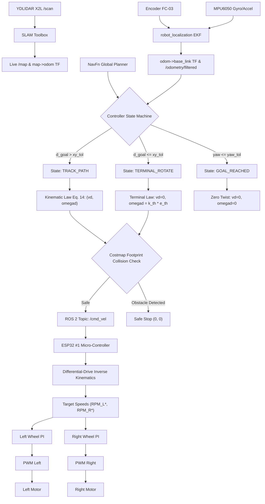

# Nonholonomic Kinematic Trajectory Tracking Controller
## Technical Model, Architecture & Control Law Formulation

---

### 1. Architectural Clarification & System Hierarchy

A fundamental requirement of mobile robotics control architecture is the strict separation between **Whole-Robot Trajectory Tracking** and **Low-Level Actuator Speed Control**:

* **Incorrect Description**: *"The robot controller consists of two PI controllers running on the wheels."*
* **Correct Engineering Hierarchy**:
  1. **Global Path Planner (NavFn / A*)**: Generates geometric Cartesian path from start to goal.
  2. **Path-to-Reference Adapter (Nav2 Integration)**: Extracts continuous reference pose and feedforward reference velocities $(x_r, y_r, \theta_r, v_r, \omega_r)$.
  3. **Whole-Robot Kinematic Controller (Supervisor's Paper Eq. 14)**: Computes required robot body velocity commands $(v_d, \omega_d)$ to asymptotically stabilize tracking errors $(e_1, e_2, e_3) \to 0$.
  4. **Terminal Orientation State Machine (Nav2 Extension)**: Regulates in-place rotation when the robot reaches the terminal XY goal region.
  5. **Footprint Collision Checker (Local Costmap Prediction)**: Forward simulates candidate trajectories to ensure collision-free motion before issuing commands.
  6. **Differential-Drive Inverse Kinematics (Paper Eq. 15–16)**: Translates $(v_d, \omega_d)$ into independent left and right wheel target rotational speeds $(\omega_{L,\text{des}}, \omega_{R,\text{des}})$.
  7. **Low-Level Actuator PI Controllers (ESP32 #1 Firmware)**: Regulates wheel motor PWM voltages to track the requested target RPMs.

---

### 2. Differential-Drive Robot Kinematic Model

#### 2.1 Coordinate Frames & Physical Parameters
* **Robot Pose Vector**: $p = [x, y, \theta]^T \in \mathbb{R}^3$, defined at the **midpoint of the driving wheel axle** ($base\_link$).
* **Wheel Radius**: $r = 0.0325\text{ m}$ (Wheel diameter $D = 0.065\text{ m}$).
* **Half Wheel Separation (Track)**: $b = 0.055\text{ m}$ (Total wheel separation $L = 2b = 0.110\text{ m}$).
* **Encoder Resolution**: $\text{PPR} = 38\text{ pulses/rev}$.
* **Footprint Bounds**: $[-0.08\text{ m}, -0.08\text{ m}] \times [+0.08\text{ m}, +0.08\text{ m}]$.

#### 2.2 Nonholonomic Constraint
Under the standard assumption of pure rolling without lateral slipping:
$$-\dot{x}\sin\theta + \dot{y}\cos\theta = 0$$

#### 2.3 Forward Kinematics (State-Space Model)
$$\begin{bmatrix} \dot{x} \\ \dot{y} \\ \dot{\theta} \end{bmatrix} = \begin{bmatrix} \cos\theta & 0 \\ \sin\theta & 0 \\ 0 & 1 \end{bmatrix} \begin{bmatrix} v \\ \omega \end{bmatrix}$$
where $u = [v, \omega]^T$ is the control input vector containing linear velocity $v$ and angular velocity $\omega$.

---

### 3. Reference Trajectory Model & Integration Bridge

The virtual reference robot satisfies:
$$\begin{bmatrix} \dot{x}_r \\ \dot{y}_r \\ \dot{\theta}_r \end{bmatrix} = \begin{bmatrix} \cos\theta_r & 0 \\ \sin\theta_r & 0 \\ 0 & 1 \end{bmatrix} \begin{bmatrix} v_r \\ \omega_r \end{bmatrix}$$

> [!NOTE]
> *Integration Scope*: The paper assumes a continuous reference $(x_r, y_r, \theta_r, v_r, \omega_r)$. In ROS 2, NavFn outputs a discrete geometric path $P = \{p_0, \dots, p_N\}$. The **Path-to-Reference Adapter** is our integration layer that computes:
> $$\theta_r = \text{atan2}(\Delta y, \Delta x), \quad v_r = \text{nominal\_vel}, \quad \omega_r = v_r \kappa_r$$
> where $\kappa_r = \frac{\Delta\theta}{\Delta s}$ is the estimated local path curvature.

---

### 4. Tracking Error Formulation (Paper Eq. 13)

$$\begin{bmatrix} e_1 \\ e_2 \\ e_3 \end{bmatrix} = \begin{bmatrix} \cos\theta & \sin\theta & 0 \\ -\sin\theta & \cos\theta & 0 \\ 0 & 0 & 1 \end{bmatrix} \begin{bmatrix} x_r - x \\ y_r - y \\ \text{wrap\_to\_pi}(\theta_r - \theta) \end{bmatrix}$$

* $e_1$: Longitudinal tracking error.
* $e_2$: Lateral (cross-track) tracking error.
* $e_3$: Heading angle error normalized to $[-\pi, +\pi]$.

---

### 5. Whole-Robot Kinematic Control Law (Paper Eq. 14)

$$\boxed{v_d = v_r \cos(e_3) + k_1 e_1}$$
$$\boxed{\omega_d = \omega_r + k_2 v_r e_2 + k_3 v_r \sin(e_3)}$$

where $k_1 > 0, k_2 > 0, k_3 > 0$ are controller gains.

> [!IMPORTANT]
> *Theoretical Boundary Statement*: The Lyapunov stability proof applies strictly to the ideal continuous kinematic subsystem analyzed in the paper. The complete Nav2 integration incorporates discrete lookahead selection, velocity saturation, terminal state switching, and costmap collision checking, which are validated experimentally.

---

### 6. Terminal Goal Orientation Control & State Machine

When the robot reaches the terminal XY goal region ($d_{\text{goal}} \le \text{xy\_goal\_tolerance}$), the paper's tracking law cannot independently orient the vehicle because $v_r \to 0 \implies \omega_d \to 0$.

An explicit terminal state machine resolves this:
1. **`TRACK_PATH`**: Normal kinematic tracking when $d_{\text{goal}} > \text{xy\_goal\_tolerance}$.
2. **`TERMINAL_ROTATE`**: When $d_{\text{goal}} \le \text{xy\_goal\_tolerance}$ and $|e_{\theta}| > \text{yaw\_goal\_tolerance}$:
   $$v_d = 0.0, \quad \omega_d = \text{clamp}(k_{\theta,\text{terminal}} \cdot e_{\theta}, -\omega_{\text{max}}, \omega_{\text{max}})$$
   where $e_{\theta} = \text{wrap\_to\_pi}(\theta_{\text{goal}} - \theta_{\text{robot}})$.
3. **`GOAL_REACHED`**: When $|e_{\theta}| \le \text{yaw\_goal\_tolerance}$:
   $$v_d = 0.0, \quad \omega_d = 0.0$$

---

### 7. Local Costmap Forward Collision Checking

Before issuing candidate command $(v_d, \omega_d)$, the controller forward simulates the robot state over prediction horizon $T = 0.8\text{ s}$ ($\Delta t = 0.05\text{ s}$):
$$x_{k+1} = x_k + v_d \cos\theta_k \Delta t, \quad y_{k+1} = y_k + v_d \sin\theta_k \Delta t, \quad \theta_{k+1} = \theta_k + \omega_d \Delta t$$

At each step, `nav2_costmap_2d::FootprintCollisionChecker` evaluates the rectangular footprint $[-0.08, -0.08] \to [+0.08, +0.08]$ on the local costmap. If $\text{cost} \ge 253$ (Lethal/Inscribed Obstacle) or out-of-bounds, the candidate command is rejected and a safe stop $(0, 0)$ is commanded.

---

### 8. Differential-Drive Inverse Kinematics (Paper Eq. 15–16)

$$\omega_{R,\text{des}} = \frac{v_d + b \omega_d}{r}, \quad \omega_{L,\text{des}} = \frac{v_d - b \omega_d}{r}$$
$$\text{RPM}_R = \frac{\omega_{R,\text{des}} \times 60}{2\pi}, \quad \text{RPM}_L = \frac{\omega_{L,\text{des}} \times 60}{2\pi}$$
with $r = 0.0325\text{ m}, b = 0.055\text{ m}$.
